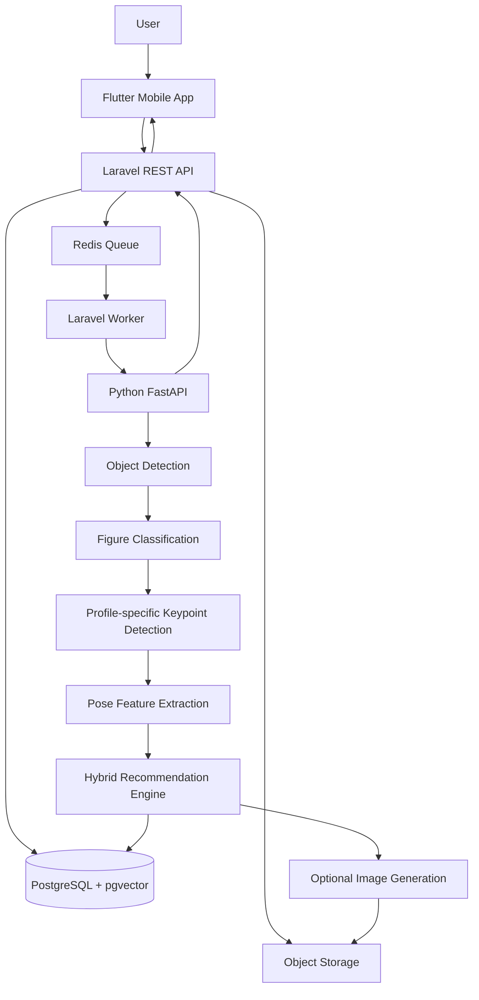
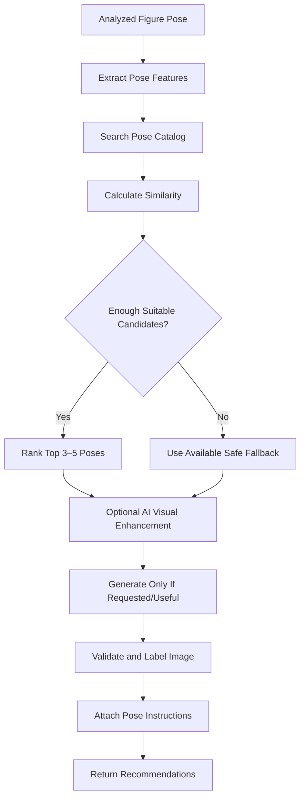
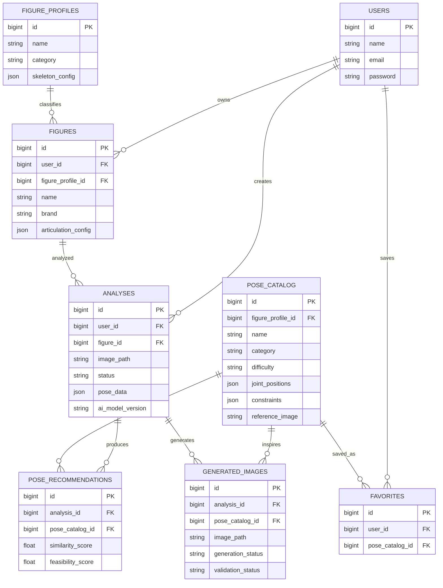

# FigurePose AI — Product Requirements Document & Technical Development Blueprint

**Document version:** 1.0  
**Status:** Draft  
**Date:** 9 November 2026  
**Product type:** Cross-platform mobile application  
**Product category:** Computer Vision, AI Pose Recommendation, Figure Photography

---

## 1. Product Overview

### 1.1 Product Name

**FigurePose AI** (working title).

### 1.2 Product Vision

FigurePose AI is a mobile application that helps action-figure collectors discover practical, visually appealing poses from a photo of a figure they own.

Users upload or capture a photo. The application analyzes the figure and its visible articulation, then recommends alternative poses with reference images and instructions for adjusting the figure's joints.

### 1.3 Problem Statement

Action-figure collectors, photographers, and hobbyists can run out of ideas for posing their figures. They may also find it difficult to translate an attractive reference image into specific adjustments to the figure's head, torso, arms, legs, and other articulated parts.

### 1.4 Proposed Solution

FigurePose AI combines computer vision, a curated pose catalog, pose-matching algorithms, and optional AI image generation to provide:

- Figure detection and classification.
- Pose and keypoint analysis for supported figure profiles.
- Three to five pose recommendations per analysis.
- Reference images and step-by-step joint instructions.
- Favorites and analysis history.

### 1.5 Product Configuration

| Decision | Selected configuration |
|---|---|
| Recommendation method | Hybrid: curated catalog + AI-generated visual references |
| Supported figure scope | All figure types as the long-term product goal |
| MVP figure profiles | Humanoid, anime-style humanoid, and mecha/robot |
| Recommendation output | Reference image + joint instructions |
| Mobile platform | Android and iOS |
| MVP architecture | Flutter + Laravel + Python FastAPI |

**Scope clarification:** The product vision supports many figure types, but the MVP should initially validate a limited number of skeleton profiles. Creature and custom profiles can follow after the profile system is proven.

---

## 2. Target Users

| User segment | Needs |
|---|---|
| Action-figure collectors | Fresh ideas for displaying collections |
| Figure photographers | Dynamic and cinematic posing references |
| Hobbyists | Guidance on articulated joints |
| Content creators | Pose concepts for social-media content |
| Beginner collectors | Easy-to-follow posing instructions |

### 2.1 Primary Persona: Action-Figure Collector

- Owns one or more articulated figures.
- Takes photos or displays figures.
- Wants dynamic, natural-looking poses.
- Sometimes struggles to think of new poses.

### 2.2 Secondary Persona: Beginner Collector

- Is new to action figures.
- May not know the figure's articulation limits.
- Needs clear visual and written guidance.

---

## 3. Product Goals and Success Metrics

### 3.1 Goals

1. Make it easier to discover new figure poses.
2. Analyze a supported figure's visible pose from a photo.
3. Recommend relevant and physically plausible pose references.
4. Explain how to reproduce a recommendation using the figure's joints.
5. Build a reusable pose catalog and collection of saved references.

### 3.2 Initial MVP Targets

These are targets to validate, not guaranteed performance:

| Metric | Initial target |
|---|---:|
| Figure detection success on supported test images | ≥ 85% |
| Typical analysis response time | ≤ 15 seconds, subject to hardware and image-generation path |
| Recommendations per successful analysis | 3–5 |
| Users saving at least one recommendation | ≥ 30% |
| Successful image uploads | ≥ 95% |

Model metrics must be measured on a representative, held-out action-figure dataset. Detection success alone does not establish keypoint or recommendation quality.

---

## 4. Functional Requirements

Priority definitions:

- **P0:** Required for MVP.
- **P1:** Important, but can follow the initial MVP.
- **P2:** Later enhancement.

### 4.1 Authentication and User Management

| ID | Requirement | Priority |
|---|---|---|
| AUTH-01 | Register with email and password | P1 |
| AUTH-02 | Sign in with email and password | P1 |
| AUTH-03 | Support Google sign-in | P2 |
| AUTH-04 | View and edit profile | P2 |
| AUTH-05 | Try the core analysis flow without creating an account | P0 |
| AUTH-06 | Require an account for cloud-synced favorites and collections | P1 |

### 4.2 Image Upload and Validation

| ID | Requirement | Priority |
|---|---|---|
| IMG-01 | Select a photo from the gallery | P0 |
| IMG-02 | Capture a photo using the camera | P0 |
| IMG-03 | Preview the image before analysis | P0 |
| IMG-04 | Crop and rotate the image | P1 |
| IMG-05 | Validate supported image formats: JPEG, PNG, WebP | P0 |
| IMG-06 | Validate image size, dimensions, and quality | P0 |
| IMG-07 | Detect whether a supported figure is present | P0 |
| IMG-08 | Detect multiple figures and allow selection of the target | P1 |
| IMG-09 | Show a useful error when the image is blurry, obscured, or unsuitable | P0 |

### 4.3 Figure Detection and Classification

| ID | Requirement | Priority |
|---|---|---|
| FIG-01 | Detect figure bounding boxes | P0 |
| FIG-02 | Classify supported figure profiles | P0 |
| FIG-03 | Allow manual profile selection when automatic classification is uncertain | P0 |
| FIG-04 | Allow users to select a detected figure in a multi-figure image | P1 |
| FIG-05 | Support additional profiles through configuration rather than hard-coded assumptions | P1 |

Initial profiles:

- `humanoid_v1`
- `anime_v1`
- `mecha_v1`

Future profiles may include creature and user-configurable skeletons.

### 4.4 Pose Estimation and Analysis

| ID | Requirement | Priority |
|---|---|---|
| POSE-01 | Detect profile-specific keypoints | P0 |
| POSE-02 | Return normalized keypoint coordinates | P0 |
| POSE-03 | Return confidence and visibility for each keypoint | P0 |
| POSE-04 | Estimate visible joint angles where geometry permits | P0 |
| POSE-05 | Estimate body orientation and camera-view information | P1 |
| POSE-06 | Produce a pose feature representation for matching | P0 |
| POSE-07 | Identify insufficiently visible or occluded joints | P0 |

A single 2D image cannot reliably reveal all 3D joint angles or hidden geometry. The MVP must describe outputs as 2D estimates or approximate pose guidance, and must not claim full 3D reconstruction.

### 4.5 Hybrid Pose Recommendation

| ID | Requirement | Priority |
|---|---|---|
| REC-01 | Return 3–5 recommendations when enough suitable catalog data exists | P0 |
| REC-02 | Retrieve candidates from the curated pose catalog | P0 |
| REC-03 | Rank candidates using pose similarity and category relevance | P0 |
| REC-04 | Evaluate articulation feasibility when profile constraints are available | P0 |
| REC-05 | Include name, category, difficulty, and reference image | P0 |
| REC-06 | Include instructions for changing body parts or joints | P0 |
| REC-07 | Allow users to request alternative recommendations | P1 |
| REC-08 | Optionally request an AI-generated visual reference | P1 |
| REC-09 | Label generated images clearly as AI-generated | P0 |
| REC-10 | Distinguish generated images from physically validated references | P0 |

**Recommended MVP behavior:** curated catalog matching is the dependable baseline. Image generation is an optional enhancement and should not be required for every analysis. Generated images must not be presented as mechanically verified instructions unless they pass a separate validation process.

### 4.6 Pose Detail and Instructions

Each pose detail should display:

- Pose name and category.
- Reference image.
- Difficulty.
- Short description.
- Head and torso guidance.
- Arm and leg guidance.
- Joint angles or movement directions where supported.
- Warnings when a movement may exceed the known articulation range.
- Whether the image is catalog-sourced or AI-generated.

### 4.7 Favorites and History

| ID | Requirement | Priority |
|---|---|---|
| FAV-01 | Save a catalog pose as a favorite | P0 |
| FAV-02 | View saved poses | P0 |
| FAV-03 | Remove a favorite | P0 |
| FAV-04 | Group favorites by category | P2 |
| HIST-01 | View previous analyses | P1 |
| HIST-02 | Open a previous analysis result | P1 |
| HIST-03 | Delete an analysis and associated user image | P1 |

---

## 5. User Journey

1. User opens the application.
2. User captures or selects a figure photo.
3. User previews and confirms the photo.
4. System validates image quality and detects figures.
5. User confirms or selects the figure profile if needed.
6. System analyzes keypoints and visible pose features.
7. Recommendation engine searches and ranks catalog poses.
8. Optional image-generation service creates additional visual references.
9. System returns recommendations and instructions.
10. User opens a pose detail and saves it if desired.

### 5.1 Analysis State Lifecycle

```text
pending → processing → completed
                    ↘ failed → retry (if eligible)
```

The mobile application should display progress and recoverable errors. Analysis should run asynchronously rather than holding the upload request open until all AI work is complete.

---

## 6. UI/UX Requirements

### 6.1 Required Screens

| Screen | Purpose |
|---|---|
| Splash | Brand and application startup |
| Onboarding | Explain the core value |
| Home | Upload entry point and discovery |
| Upload | Camera and gallery selection |
| Image Preview | Confirm, crop, or rotate photo |
| Figure Selection | Select detected object/profile if needed |
| Processing | Show analysis progress |
| Recommendations | Display 3–5 pose cards |
| Pose Detail | Show image and joint instructions |
| Pose Gallery | Browse catalog |
| Favorites | View saved poses |
| History | View previous analyses |
| Profile | Account and settings |

### 6.2 Design Direction

- Dark theme as the primary theme.
- Charcoal or near-black surfaces.
- Electric blue or purple accent color.
- Card-based layout with images as the main focus.
- Simple navigation with up to four primary destinations.
- Clear distinction between catalog images and AI-generated images.
- Accessible text contrast and readable joint instructions.

Suggested main navigation:

1. Home
2. Discover / Pose Gallery
3. Favorites
4. Profile

---

## 7. Technical Architecture

### 7.1 Recommended Technology Stack

| Layer | Technology | Responsibility |
|---|---|---|
| Mobile | Flutter | Android/iOS client |
| Backend | Laravel | REST API, authentication, business logic |
| AI service | Python + FastAPI | Computer vision and recommendation |
| Database | PostgreSQL | Application data |
| Vector search | pgvector | Pose embedding similarity |
| Object detection | YOLO-family model | Figure detection |
| Pose estimation | Custom keypoint model | Profile-specific keypoints |
| Image generation | External image-generation API | Optional visual references |
| Queue | Redis | Background jobs |
| Storage | S3-compatible storage or MinIO | Image storage |
| Deployment | Docker Compose | MVP deployment |

Model and provider selection should be validated through a small technical proof of concept. YOLO is an object-detection family; it does not automatically solve action-figure-specific articulation estimation.

### 7.2 High-Level Architecture



### 7.3 Service Responsibilities

**Flutter**
- Camera and gallery access.
- Photo upload and preview.
- Analysis progress.
- Recommendation and pose-detail screens.
- Favorites and history.

**Laravel**
- Authentication and authorization.
- Figure and profile management.
- Analysis lifecycle and queue dispatch.
- Pose catalog and recommendation persistence.
- Storage access and API response formatting.
- Communication with the AI service.

**Python FastAPI**
- Image preprocessing.
- Object detection.
- Figure profile classification.
- Keypoint inference.
- Pose feature extraction.
- Pose matching and feasibility scoring.
- Optional image-generation orchestration.

---

## 8. AI System Specification

### 8.1 Processing Pipeline

1. **Image input:** validate and preprocess the uploaded photo.
2. **Object detection:** locate figure bounding boxes and, where available, segmentation masks.
3. **Figure classification:** select a supported figure profile.
4. **Keypoint detection:** infer profile-specific visible joints and landmarks.
5. **Pose feature extraction:** normalize coordinates and calculate suitable geometric features.
6. **Catalog matching:** retrieve and rank candidate poses.
7. **Optional generation:** create an additional reference image using a target pose and source image, subject to user consent and provider policy.
8. **Validation:** check the generated output against the target pose and label its validation status.
9. **Result delivery:** return images, metadata, instructions, and limitations.

### 8.2 Skeleton Profiles

Each profile defines its own keypoints, connections, and joint constraints.

Example humanoid profile:

```json
{
  "profile": "humanoid_v1",
  "keypoints": [
    "head",
    "neck",
    "left_shoulder",
    "right_shoulder",
    "left_elbow",
    "right_elbow",
    "left_wrist",
    "right_wrist",
    "chest",
    "waist",
    "left_hip",
    "right_hip",
    "left_knee",
    "right_knee",
    "left_ankle",
    "right_ankle"
  ]
}
```

Mecha profiles may define different segment names, extra joints, or non-human structures. Creature profiles may include tails, additional limbs, or quadruped arrangements. Do not force every figure into a human skeleton.

### 8.3 Pose Estimation Output

Example response structure:

```json
{
  "figure_type": "humanoid",
  "profile": "humanoid_v1",
  "keypoints": {
    "left_shoulder": {
      "x": 0.32,
      "y": 0.25,
      "confidence": 0.96,
      "visibility": "visible"
    },
    "left_elbow": {
      "x": 0.22,
      "y": 0.42,
      "confidence": 0.91,
      "visibility": "visible"
    }
  },
  "orientation": "front",
  "pose_embedding": [0.12, 0.45, 0.31]
}
```

Coordinates are normalized to a 0–1 range. The embedding dimensions and model version must be defined by the trained model rather than hard-coded from this illustrative example.

### 8.4 Hybrid Recommendation Engine

The engine combines:

- **Curated pose catalog:** references with known metadata and instructions.
- **AI-generated references:** optional additional visuals for a selected target pose.

Recommended flow:



Do not only recommend poses that resemble the input. The engine should find useful alternatives while considering category, difficulty, pose diversity, and physical feasibility.

An initial similarity formula can be:

\[
S = w_1S_{angle} + w_2S_{position} + w_3S_{embedding}
\]

Where:

- `S_angle`: joint-angle similarity.
- `S_position`: normalized keypoint-position similarity.
- `S_embedding`: learned pose-embedding similarity.
- `w1 + w2 + w3 = 1`.

Illustrative starting weights:

| Feature | Weight |
|---|---:|
| Joint angle | 40% |
| Keypoint position | 35% |
| Pose embedding | 25% |

These weights must be tuned against a labeled evaluation set. The final ranking should also include feasibility and diversity; similarity alone is not sufficient.

### 8.5 Articulation and Feasibility

Store articulation constraints per figure profile or, where known, per individual figure model.

A feasibility check should:

- Reject or warn about movements outside configured joint ranges.
- Avoid giving confident instructions for occluded or uncertain joints.
- Account for profile-specific joint structure.
- Distinguish estimated limits from verified manufacturer/model limits.
- Explain when the user must manually inspect the figure.

Example joint configuration:

| Joint | Illustrative minimum | Illustrative maximum |
|---|---:|---:|
| Elbow | 0° | 145° |
| Knee | 0° | 135° |
| Shoulder | -90° | 180° |
| Hip | -45° | 120° |

These values are examples only, not universal limits for all action figures.

### 8.6 Image Generation Specification

Image generation should preserve, as far as the selected model permits:

- Figure identity and general design.
- Main colors and accessories.
- Number and arrangement of limbs.
- Target pose and body-part positions.
- Neutral or requested background.

Generation input should include the source image, target pose, profile, and explicit constraints.

Every generated image must have separate states:

- `generated`: image generation completed.
- `validated`: image checked against the intended pose.
- `rejected`: validation failed.

A generated image must be labeled as AI-generated. Visual plausibility is not proof of mechanical feasibility. Do not present generated joint instructions as verified unless independently checked.

---

## 9. Backend Development Blueprint

### 9.1 Laravel Project Structure

```text
figurepose-backend/
├── app/
│   ├── Models/
│   │   ├── User.php
│   │   ├── Figure.php
│   │   ├── FigureProfile.php
│   │   ├── Analysis.php
│   │   ├── PoseCatalog.php
│   │   ├── PoseRecommendation.php
│   │   ├── GeneratedImage.php
│   │   └── Favorite.php
│   ├── Http/
│   │   ├── Controllers/Api/
│   │   │   ├── AuthController.php
│   │   │   ├── FigureController.php
│   │   │   ├── AnalysisController.php
│   │   │   ├── PoseController.php
│   │   │   └── FavoriteController.php
│   │   ├── Requests/
│   │   └── Resources/
│   ├── Services/
│   │   ├── FigureService.php
│   │   ├── AnalysisService.php
│   │   ├── AIService.php
│   │   ├── RecommendationService.php
│   │   └── StorageService.php
│   ├── Jobs/
│   │   ├── ProcessFigureAnalysis.php
│   │   └── GeneratePoseImage.php
│   └── Enums/
├── database/
│   ├── migrations/
│   └── seeders/
├── routes/
│   └── api.php
└── docker-compose.yml
```

Keep controllers thin. Business logic belongs in services, and long-running analysis or generation belongs in queued jobs.

### 9.2 Python AI Service Structure

```text
figurepose-ai/
├── app/
│   ├── main.py
│   ├── api/
│   │   └── endpoints/
│   │       ├── detection.py
│   │       ├── classification.py
│   │       ├── estimation.py
│   │       ├── recommendation.py
│   │       └── generation.py
│   ├── models/
│   │   ├── object_detector.py
│   │   ├── figure_classifier.py
│   │   └── pose_estimator.py
│   ├── services/
│   │   ├── image_processor.py
│   │   ├── pose_extractor.py
│   │   ├── pose_matcher.py
│   │   └── image_generator.py
│   ├── schemas/
│   │   ├── figure.py
│   │   ├── pose.py
│   │   └── recommendation.py
│   ├── configs/
│   │   └── skeleton_profiles/
│   └── utils/
├── datasets/
├── weights/
├── tests/
├── requirements.txt
└── Dockerfile
```

### 9.3 Backend Service Responsibilities

| Service | Responsibility |
|---|---|
| FigureService | Manage users' figure records |
| AnalysisService | Manage analysis lifecycle |
| AIService | Call FastAPI endpoints |
| RecommendationService | Persist and format recommendation results |
| StorageService | Manage image uploads and access |

---

## 10. Database Design

### 10.1 Main Entities

| Table | Purpose |
|---|---|
| users | User accounts |
| figure_profiles | Skeleton and category profiles |
| figures | Figures owned by users |
| analyses | Uploaded image and analysis state |
| pose_catalog | Curated pose references and instructions |
| pose_recommendations | Ranked recommendations for an analysis |
| generated_images | AI-generated reference image records |
| favorites | Saved catalog poses |

### 10.2 Entity Relationship Diagram



### 10.3 Database Design Notes

- `figure_profiles.skeleton_config` stores profile-specific keypoint definitions and connections.
- `figures.articulation_config` stores known articulation constraints for a particular figure.
- `analyses.pose_data` stores structured model output, including keypoints, confidence, profile, and model version.
- `pose_catalog.joint_positions` stores target pose data.
- `pose_catalog.constraints` stores feasibility-related metadata.
- `generated_images` records the source analysis, target pose, generation state, and validation state.
- Use foreign keys, ownership checks, timestamps, and appropriate deletion policies.

### 10.4 Indexing

Example indexes:

```sql
CREATE INDEX idx_analyses_user_id ON analyses(user_id);
CREATE INDEX idx_analyses_status ON analyses(status);
CREATE INDEX idx_poses_profile_category
    ON pose_catalog(figure_profile_id, category);
CREATE INDEX idx_recommendations_analysis
    ON pose_recommendations(analysis_id);
```

Enable pgvector and add a vector column/index only after selecting and fixing the embedding model and vector dimensions.

---

## 11. REST API Specification

All endpoints use the `/api/v1` prefix.

### 11.1 Endpoint List

| Method | Endpoint | Description |
|---|---|---|
| POST | `/auth/register` | Register |
| POST | `/auth/login` | Login |
| GET | `/figures/profiles` | List supported profiles |
| POST | `/figures` | Add a user's figure |
| GET | `/figures` | List user's figures |
| POST | `/analyses` | Upload photo and start analysis |
| GET | `/analyses/{id}` | Get status or result |
| GET | `/poses` | Browse pose catalog |
| GET | `/poses/{id}` | Get pose detail |
| POST | `/poses/{id}/generate` | Request generated visual |
| GET | `/generated-images/{id}` | Get generation status |
| POST | `/favorites` | Add favorite |
| GET | `/favorites` | List favorites |
| DELETE | `/favorites/{id}` | Remove favorite |

### 11.2 Start Analysis

`POST /api/v1/analyses`

Content type: `multipart/form-data`.

| Parameter | Type | Required |
|---|---|---|
| image | File | Yes |
| figure_id | Integer | No |
| figure_profile_id | Integer | No |
| analysis_mode | String | Yes |

Supported `analysis_mode` values:

- `automatic`: system attempts to classify the figure.
- `manual`: user supplies a selected figure profile.

If automatic classification confidence is low, ask the user to confirm or select a profile.

Example response:

```json
{
  "success": true,
  "message": "Analysis started",
  "data": {
    "analysis_id": 120,
    "status": "pending"
  }
}
```

### 11.3 Analysis Result

`GET /api/v1/analyses/{id}`

Example response:

```json
{
  "success": true,
  "data": {
    "analysis_id": 120,
    "status": "completed",
    "figure_type": "humanoid",
    "recommendations": [
      {
        "id": 1,
        "name": "Heroic Landing",
        "source": "catalog",
        "difficulty": "medium",
        "similarity_score": 0.91,
        "feasibility_score": 0.94,
        "image_url": "https://storage.example.com/pose-01.jpg",
        "instructions": [
          {
            "body_part": "left_arm",
            "movement": "raise",
            "target_angle": 75,
            "angle_reference": "defined_by_profile"
          },
          {
            "body_part": "right_arm",
            "movement": "bend",
            "target_angle": 90,
            "angle_reference": "defined_by_profile"
          }
        ]
      }
    ]
  }
}
```

Values are illustrative. Production scores and angles must come from documented algorithms and validated data.

### 11.4 API and Job Behavior

- Return an analysis ID immediately after accepting an upload.
- Process the analysis in a background queue.
- Let the mobile client poll the analysis endpoint every 2–3 seconds initially, with timeout and backoff.
- Return stable status values: `pending`, `processing`, `completed`, `failed`.
- Ensure users can only access their own analyses and generated images.
- Use idempotency or duplicate-request protection for generation jobs where appropriate.

---

## 12. Flutter Mobile Blueprint

### 12.1 Project Structure

Use a feature-first structure with separation between data, domain, and presentation layers.

```text
figurepose-mobile/
├── lib/
│   ├── main.dart
│   ├── core/
│   │   ├── network/
│   │   ├── constants/
│   │   ├── theme/
│   │   ├── storage/
│   │   └── utils/
│   ├── features/
│   │   ├── auth/
│   │   │   ├── data/
│   │   │   ├── domain/
│   │   │   └── presentation/
│   │   ├── home/
│   │   ├── upload/
│   │   ├── analysis/
│   │   ├── recommendation/
│   │   ├── pose_detail/
│   │   ├── favorites/
│   │   ├── history/
│   │   └── profile/
│   └── shared/
│       ├── widgets/
│       └── models/
├── assets/
│   ├── images/
│   ├── icons/
│   └── animations/
└── pubspec.yaml
```

### 12.2 Recommended Packages

| Package | Purpose |
|---|---|
| `dio` | HTTP client |
| `flutter_riverpod` | State management |
| `go_router` | Navigation |
| `image_picker` | Camera and gallery |
| `cached_network_image` | Image caching |
| `flutter_secure_storage` | Secure token storage |
| `freezed` | Immutable models |
| `json_serializable` | JSON serialization |

### 12.3 Main Navigation

1. Home — upload and recent activity.
2. Discover — browse pose gallery.
3. Favorites — saved poses.
4. Profile — account and settings.

---

## 13. Pose Instruction Engine

Each recommendation should have structured, machine-readable instructions.

Example:

```json
{
  "pose_name": "Heroic Landing",
  "instructions": [
    {
      "body_part": "torso",
      "movement": "lean_forward",
      "target_angle": 15,
      "priority": "high"
    },
    {
      "body_part": "left_knee",
      "movement": "bend",
      "target_angle": 90,
      "priority": "high"
    },
    {
      "body_part": "right_arm",
      "movement": "raise",
      "target_angle": 70,
      "priority": "medium"
    }
  ]
}
```

The angle convention must be documented per skeleton profile. A bare angle without a defined reference axis or joint convention is ambiguous.

The pose-detail screen should include:

- Reference image.
- Pose name and category.
- Difficulty level.
- Step-by-step joint instructions.
- Optional skeleton overlay.
- Feasibility warnings.
- Save-favorite action.
- Generate-alternative action.

---

## 14. AI Dataset Development

### 14.1 Dataset Structure

```text
dataset/
├── images/
│   ├── humanoid/
│   ├── anime/
│   ├── mecha/
│   └── creature/
├── annotations/
│   ├── object_detection/
│   ├── keypoints/
│   └── segmentation/
├── skeleton_profiles/
│   ├── humanoid_v1.json
│   ├── anime_v1.json
│   ├── mecha_v1.json
│   └── creature_v1.json
└── metadata/
    ├── image_labels.csv
    └── pose_labels.csv
```

### 14.2 Annotation Requirements

Each training/evaluation image should include, where applicable:

- Figure bounding box.
- Figure category/profile.
- Keypoint coordinates.
- Keypoint visibility/occlusion.
- Pose category.
- Camera angle.
- Articulation profile.
- Annotation provenance and usage rights.

Do not force annotators to guess hidden joints. Mark uncertain or occluded keypoints appropriately.

### 14.3 Initial Dataset Strategy

Suggested planning targets:

| Stage | Initial target |
|---|---:|
| Prototype dataset | 500–1,000 images |
| Expanded iteration | 2,000–5,000 images |

These are planning estimates, not guarantees of accuracy. Dataset diversity, label quality, and held-out evaluation are more important than raw image count.

Use images that the team owns, has permission to use, or can lawfully use for the intended training and product purposes.

---

## 15. Non-Functional Requirements

| Category | Requirement |
|---|---|
| Performance | Target typical analysis completion within 15 seconds under defined test conditions |
| Scalability | AI inference can scale independently from Laravel |
| Security | HTTPS, authorization, upload validation |
| Privacy | Clear retention policy; no training use without appropriate consent |
| Availability | Initial backend uptime target: 99% |
| Compatibility | Android and iOS |
| Maintainability | Separate mobile, backend, and AI services |
| Reliability | Explicit job states, retry policy, and error handling |
| Observability | Structured logs, request IDs, and job monitoring |
| Storage | Private original-image storage and controlled access |

### 15.1 Privacy Requirements

- Explain why a photo is processed and which external services may receive it.
- Obtain appropriate consent before sending photos to third-party image-generation services.
- Use private storage and expiring access URLs.
- Provide a way to delete user photos and associated analysis data.
- Define retention periods for original images and generated images.
- Do not store credentials, tokens, or unnecessary personal data in logs.

---

## 16. Testing and Acceptance Criteria

### 16.1 Backend Tests

- Authentication and authorization.
- Upload validation.
- Figure ownership.
- Analysis state transitions.
- AI-service failure and timeout handling.
- Recommendation persistence.
- Favorite management.
- Generated-image access control.

### 16.2 AI Tests

- Object detection precision/recall on a held-out dataset.
- Figure-profile classification performance.
- Keypoint localization error.
- Visibility/occlusion handling.
- Pose-matching relevance.
- Feasibility scoring.
- Generated-image consistency and labeling.

### 16.3 Mobile Tests

- Camera permission.
- Gallery access.
- Upload success and failure.
- Processing/loading state.
- API timeout and retry.
- Image loading and caching.
- Navigation and empty states.
- Session handling.

### 16.4 MVP Acceptance Criteria

- [ ] User can select or capture a photo.
- [ ] Invalid or unsuitable images receive clear feedback.
- [ ] At least three initial figure profiles are represented in the system.
- [ ] At least one profile has a measured, functioning keypoint-estimation prototype.
- [ ] Successful analyses can retrieve suitable catalog recommendations.
- [ ] Recommendation detail includes image and structured instructions.
- [ ] Generated images, when available, are labeled as AI-generated.
- [ ] Users can save and remove favorites.
- [ ] The application handles AI-service failures gracefully.
- [ ] User data is protected by authorization checks.
- [ ] Main API and critical AI flows have automated tests.

---

## 17. Risks and Mitigation

| Risk | Mitigation |
|---|---|
| Human pose models perform poorly on figures | Build and evaluate figure-specific datasets and keypoint models |
| Different figures have different joint structures | Use configurable skeleton profiles |
| Occlusion causes uncertain keypoints | Track visibility and confidence; ask for another photo when needed |
| AI generation changes figure design | Use source-image conditioning and validation; label generated results |
| Generated pose is mechanically impossible | Apply articulation constraints and human review where needed |
| AI processing takes too long | Background jobs, worker scaling, timeouts, and optional generation |
| Dataset licensing issues | Track provenance and use rights for every dataset source |
| Infrastructure cost increases | Make generation optional and monitor inference usage |

---

## 18. Deployment Blueprint

### 18.1 Repository Structure

```text
figurepose/
├── mobile/
├── backend/
├── ai-service/
├── infrastructure/
│   ├── nginx/
│   ├── postgres/
│   └── docker/
├── docker-compose.yml
└── README.md
```

### 18.2 MVP Services

| Container | Service |
|---|---|
| `figurepose-api` | Laravel API |
| `figurepose-worker` | Laravel queue worker |
| `figurepose-ai` | FastAPI |
| `figurepose-db` | PostgreSQL with pgvector |
| `figurepose-redis` | Redis |
| `figurepose-storage` | MinIO or compatible storage |
| `figurepose-nginx` | Reverse proxy |

### 18.3 Illustrative Docker Compose

```yaml
services:
  api:
    build: ./backend
    container_name: figurepose-api
    depends_on:
      - postgres
      - redis
    ports:
      - "8000:8000"

  worker:
    build: ./backend
    container_name: figurepose-worker
    command: php artisan queue:work redis
    depends_on:
      - redis
      - postgres

  ai:
    build: ./ai-service
    container_name: figurepose-ai
    ports:
      - "8001:8001"

  postgres:
    image: pgvector/pgvector:pg17
    container_name: figurepose-db
    environment:
      POSTGRES_DB: figurepose
      POSTGRES_USER: figurepose
      POSTGRES_PASSWORD: ${DB_PASSWORD}
    volumes:
      - postgres_data:/var/lib/postgresql/data

  redis:
    image: redis:7-alpine
    container_name: figurepose-redis

  minio:
    image: minio/minio
    container_name: figurepose-storage
    command: server /data
    volumes:
      - minio_data:/data

volumes:
  postgres_data:
  minio_data:
```

This is a development-oriented starting point, not a production-ready deployment. Production requires pinned image versions, secret management, private networks, health checks, TLS, backups, storage credentials, monitoring, and a complete MinIO configuration.

### 18.4 Deployment Flow

1. Developer pushes code to Git.
2. CI pipeline builds service images.
3. Automated tests run.
4. Images are deployed to the Ubuntu Server or cloud host.
5. Laravel, FastAPI, PostgreSQL, Redis, and storage services start.
6. Health checks and smoke tests verify deployment.

Docker Compose is sufficient for the MVP. Kubernetes is not required at this stage. GPU-backed AI inference can be moved to a separate host if needed.

---

## 19. Development Roadmap

Estimated MVP timeline for a small team. Some tasks can run in parallel; custom model and dataset work are the main schedule risks.

| Sprint | Duration | Deliverable |
|---|---:|---|
| 1 | 1 week | UI/UX, repository, database and architecture setup |
| 2 | 1 week | Laravel API, authentication, storage |
| 3 | 1 week | Flutter home, upload, and gallery |
| 4 | 2 weeks | Detection and classification prototype |
| 5 | 1 week | Pose catalog and matching engine |
| 6 | 1 week | Hybrid recommendation |
| 7 | 1 week | Image-generation integration |
| 8 | 1 week | Pose instructions and favorites |
| 9 | 1 week | Integration tests and deployment |

**Estimated target: 10 weeks**, subject to model readiness, team capacity, and access to a suitable dataset.

### 19.1 Milestones

1. **Application Foundation:** Flutter, Laravel, database, storage, and FastAPI health check work.
2. **AI Prototype:** supported figure detection and at least one profile-specific keypoint pipeline work.
3. **Recommendation Engine:** catalog matching returns relevant candidates.
4. **Hybrid AI:** optional image generation is integrated and clearly labeled.
5. **MVP Release:** primary user journey passes acceptance testing.

---

## 20. Monetization Strategy

Potential future business models:

| Model | Description |
|---|---|
| Freemium | Limited free analyses |
| Premium subscription | Higher analysis and generation quotas |
| Premium pose catalog | Paid curated pose packs |
| Community features | Sharing and collection features |

Pricing and quotas should be determined after measuring inference and image-generation costs and validating user demand. Do not promise unlimited generation until costs are understood.

---

## 21. MVP Scope Boundaries

### Included

- Photo upload and camera capture.
- Image validation.
- Initial humanoid, anime-style humanoid, and mecha profiles.
- Figure detection and profile selection.
- A measured keypoint-estimation prototype.
- Curated pose catalog.
- Similarity and feasibility-based ranking.
- Three to five catalog recommendations where sufficient candidates exist.
- Reference images and joint instructions.
- Optional AI-generated reference images.
- AI-generated labels and validation state.
- Favorites.
- Basic analysis history.
- Docker-based deployment.

### Excluded from MVP

- Real-time augmented reality.
- Full 3D reconstruction.
- User-defined skeleton editor.
- Community and social feed.
- Marketplace.
- Unlimited image generation.
- Guaranteed automatic recognition of every brand and model.
- Universal articulation-limit detection for every figure.

---

## 22. Final Product Definition

**FigurePose AI** is an AI-powered mobile posing assistant for articulated figure collectors.

Its core value proposition:

> Turn your action-figure photos into practical posing inspiration.

The MVP combines:

- **Flutter:** mobile experience.
- **Laravel:** application backend.
- **FastAPI:** AI processing.
- **PostgreSQL + pgvector:** application and vector data.
- **Object detection + custom keypoint estimation:** figure and pose analysis.
- **Curated catalog + optional image generation:** hybrid recommendations.
- **Structured joint instructions:** practical guidance for reproducing poses.

The key product differentiator is not merely generating a new image. It is helping users understand how to recreate a recommended pose with the physical figure they own.

---

## 23. Recommended First Implementation Sprint

Start with the foundation before investing heavily in model training.

### Sprint 1 Deliverables

1. Create the Git repository and project structure.
2. Set up Laravel and PostgreSQL.
3. Create the initial database migrations and seeders.
4. Set up FastAPI with health-check endpoint.
5. Set up Flutter with navigation and theme.
6. Configure Docker Compose for local development.
7. Implement the first photo-upload endpoint.
8. Document local setup and environment variables.

### Sprint 1 Definition of Done

- [ ] All three application projects run locally.
- [ ] PostgreSQL connection works.
- [ ] Laravel migrations run successfully.
- [ ] FastAPI health check returns success.
- [ ] Flutter launches and displays the initial home screen.
- [ ] Docker Compose starts the required development services.
- [ ] A sample image can be uploaded and stored.
- [ ] README contains reproducible setup instructions.

**Recommended implementation order:** establish the Laravel + PostgreSQL + FastAPI foundation, connect Flutter, then build and evaluate the AI prototype using a small, properly annotated dataset.
